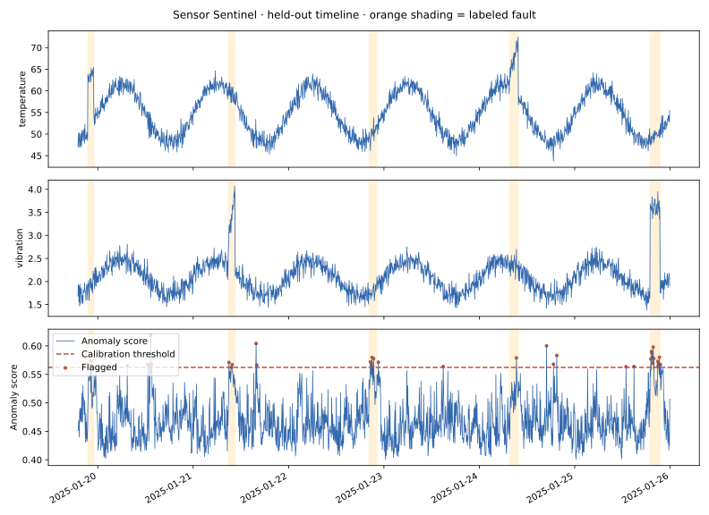

# Sensor Sentinel

Detect equipment anomalies from a single machine's regularly sampled sensor stream. Uses Isolation Forest with current and past sensor readings, a known-healthy training period, chronological evaluation, and threshold calibration against a false-positive budget.

**Bundled data and faults are synthetic. Results do not establish reliability on real equipment.**

## Run

Requires Python 3.10+:

```bash
python -m venv .venv
. .venv/bin/activate
pip install -r requirements.txt
python -m unittest discover -s tests -v
python sentinel.py --out work/demo
```

The demo generates 7,200 readings at five-minute intervals (25 days), including temperature, vibration, pressure, and load. Training covers a healthy initial half; calibration and test each cover approximately a quarter.

Outputs:

- `report.json`: split periods, thresholds, point metrics, event metrics, and limitations.
- `test_predictions.csv`: held-out readings, labels, anomaly scores, and alert flags for both detectors.
- `timeline.png` / `timeline.svg`: sensor traces, labeled faults, anomaly scores, and alerts.



## Method

1. Validate a single uninterrupted five-minute stream with finite readings and observed binary anomaly labels.
2. Derive 16 features: four current sensor values and each sensor's historical mean, historical standard deviation, and deviation from its historical mean. History uses only the previous 12 readings (one hour), excluding the current reading. No future interpolation, centered windows, or label features.
3. Fit Isolation Forest on the initial independently verified healthy period. Reject labeled training contamination. No anomaly labels select training rows within that period.
4. Exclude 12 readings at each split boundary so historical feature windows cannot overlap training, calibration, and test splits. Initial warmup and split gaps exclude 36 total readings.
5. Calibrate the alert threshold on **labeled normal calibration readings**, targeting an empirical 1% false-positive budget. Scores must be strictly greater than the conservative quantile threshold to trigger an alert. This uses validation labels to identify normal readings; it is not a fully unlabeled calibration procedure.
6. Evaluate the fixed model and threshold on later held-out readings. Do not expand one detected point into a whole detected segment when calculating point metrics.

Scores measure unusualness, not failure probability. An alert does not prove a failure or its cause. The false-positive budget controls the observed calibration rate; it does not guarantee a future rate.

## Compare with a simple baseline

The comparator uses the maximum absolute robust deviation across raw sensors, with healthy training medians and median absolute deviations. Its threshold uses the same normal calibration data and false-positive budget.

One seed-42 synthetic test run:

| Metric | Isolation Forest | Robust baseline |
| --- | ---: | ---: |
| Detected events | 5 / 5 | 4 / 5 |
| Point recall | 0.200 | 0.683 |
| Point precision | 0.600 | 0.845 |
| Average precision | 0.478 | 0.800 |
| False-positive rate on normal readings | 0.959% | 0.899% |
| False-alarm episodes / normal day | 2.76 | 2.59 |
| Median delay for detected events | 20 min | 5 min |

The simple baseline performs better on most point metrics and detected-event delay in this demo. Isolation Forest catches one additional event. These results do not justify declaring either method universally superior. There are only five held-out synthetic fault episodes; point-level discrimination and event coverage answer different questions.

The test period contains 1,788 readings (120 labeled anomalous); 3,588 training and 1,788 calibration readings are used. Full evidence: [demo report](examples/demo-report.json).

## Metric definitions

An event is one contiguous run of anomalous readings. Event recall credits an event when at least one reading within it is flagged. Delay is time from event onset to the first flag **within** the event. Missed events are counted separately; they are excluded from delay statistics, so a short delay does not imply high event recall.

A false-alarm episode is a contiguous run of flagged normal readings. An intervening unflagged or anomalous reading starts a new episode. False-alarm episodes per normal day divide that count by the duration of observed normal readings, not the total monitoring duration. Recovery-period alerts count as false alarms when their current labels are normal, even if a historical window contains a preceding fault.

## Use your own CSV

```bash
python sentinel.py --csv readings.csv --false-positive-budget 0.01 --out work/evaluation
```

The file must have exactly these columns:

| Column | Rule |
| --- | --- |
| `timestamp` | Ordered, unique timestamp every five minutes; interpreted as UTC |
| `temperature` | Finite numeric reading |
| `vibration` | Finite numeric reading |
| `pressure` | Finite numeric reading |
| `load` | Finite numeric reading |
| `anomaly` | Observed label, 0 or 1; used for offline evaluation and normal calibration |

At least 600 readings are required. The first 50% must be independently certified healthy, and the retained calibration/test periods must each contain normal and anomalous observations. Missing readings, irregular timestamps, duplicate times, and unknown columns are rejected. The CLI does not silently fill gaps. Validate sensor units and scale yourself; different equipment needs a new training/calibration run.

This is an offline single-machine benchmark, not a hosted service, streaming implementation, predictive-maintenance guarantee, or unseen-machine evaluation. Features are chronological in the sense that they never use future readings; this is not a causal inference model. Real deployment requires independently verified labels, representative fault types, machine-level evaluation, drift monitoring, and operational alert review.

## Tests and CI

14 unittest cases cover reproducibility, healthy training, invalid schema and readings, cadence, future-reading isolation, label exclusion, split-window separation, contaminated training, calibration ties, event delays and misses, no-event handling, end-to-end output, and test-label isolation.

GitHub Actions runs tests and the CLI demo, then uploads the evaluation artifacts. No paid API or external dataset is needed. Earlier custom user test steps were unavailable; the tests document the checks actually performed.
